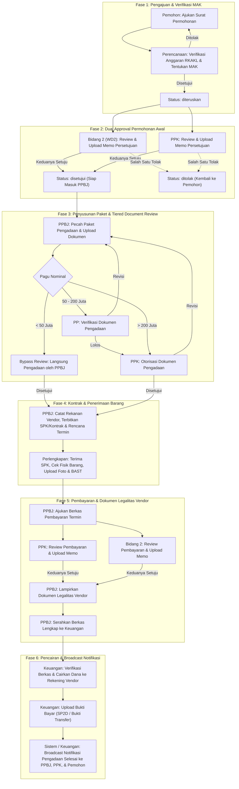

# Product Requirements Document: SIPBAJA (Sistem Informasi Pengadaan Barang dan Jasa)

## Product Overview

**Product Vision:**  
SIPBAJA adalah sistem informasi berbasis web terpusat yang mendigitalkan dan mengorkestrasi seluruh siklus pengadaan barang dan jasa di lingkungan kampus Politeknik Negeri Jakarta (PNJ). Sistem mencakup tahapan dari pengajuan surat permohonan oleh jurusan/unit, verifikasi anggaran & penetapan MAK oleh Perencanaan, persetujuan awal secara paralel (*dual approval*) oleh PPK dan Bidang 2 (Wakil Direktur II), pemecahan paket pengadaan dan *tiered review* dokumen pengadaan (<50jt, 50–200jt, >200jt), penerbitan kontrak/SPK dan penugasan rekanan vendor, pemeriksaan fisik dan serah terima barang (BAST) oleh Perlengkapan, pengajuan termin pembayaran dan pelampiran dokumen legalitas vendor, *dual approval* pembayaran oleh PPK dan Bidang 2, hingga verifikasi berkas, pencairan pembayaran, pengunggahan bukti bayar, dan *broadcast notifikasi* penyelesaian oleh bagian Keuangan.

**Target Users & Swimlanes (8 Aktor Operasional + 1 Pengelola Sistem):**
1. **Jurusan / Unit / Bidang (Pemohon):** Mengajukan surat permohonan pengadaan secara daring, melacak status dan progres real-time, merevisi permohonan bila ditolak, serta menerima notifikasi penyelesaian pembayaran pengadaan.
2. **Perencanaan:** Memverifikasi ketersediaan pagu anggaran permohonan terhadap berkas RKAKL aktif, menetapkan satu atau lebih Jenis MAK (Mata Anggaran Kegiatan), mengunggah dan mengelola dokumen RKAKL, serta menyetujui atau menolak permohonan disertai alasan perbaikan.
3. **Bidang 2 (Wakil Direktur II / WD2):** Memberikan persetujuan awal (*dual approval* permohonan) dengan menerbitkan dan mengunggah Memo Persetujuan Permohonan, serta memberikan persetujuan pembayaran termin (*dual approval* pembayaran) dengan menerbitkan dan mengunggah Memo Persetujuan Pembayaran.
4. **PPK (Pejabat Pembuat Komitmen):** Memberikan persetujuan awal (*dual approval* permohonan) sesuai MAK yang menjadi kewenangannya dengan mengunggah Memo Persetujuan Permohonan, melakukan otorisasi komitmen dokumen pengadaan (untuk paket 50–200 juta setelah diverifikasi PP, dan langsung untuk paket >200 juta), serta memberikan persetujuan pembayaran termin (*dual approval* pembayaran) dengan mengunggah Memo Persetujuan Pembayaran.
5. **PPBJ (Pejabat Pengadaan Barang dan Jasa):** Menerima permohonan yang telah disetujui penuh oleh PPK dan Bidang 2, memecah permohonan menjadi satu atau beberapa paket pengadaan, menentukan jenis pengadaan, metode pengadaan, dan level pengadaan berdasarkan pagu nominal (<50jt, 50–200jt, >200jt), mengunggah dokumen pengadaan, mencatat identitas rekanan vendor pelaksana dan nominal final kontrak, menerbitkan dokumen Kontrak/SPK/Kwitansi, menyusun rencana pembayaran per-termin dan mengatur pengingat (*reminder*) jatuh tempo, mengajukan berkas pembayaran termin, melampirkan Dokumen Legalitas Vendor setelah kedua memo persetujuan pembayaran terbit, serta menyerahkan berkas lengkap ke Keuangan.
6. **PP (Pejabat Pengadaan):** Memverifikasi dokumen pengadaan khusus untuk paket pengadaan bernilai 50–200 juta (`LevelPengadaan->perlu_review_pp == true`). Jika disetujui dokumen diteruskan ke PPK; jika ada kekurangan dokumen dikembalikan ke PPBJ disertai catatan perbaikan.
7. **Perlengkapan:** Menerima tembusan dokumen pengadaan dan SPK/kontrak, melakukan pemeriksaan fisik atas barang/jasa yang dikirim rekanan vendor, mengunggah dokumentasi foto fisik barang, serta menandatangani dan mengunggah Berita Acara Penerimaan Barang / Serah Terima (BAST).
8. **Keuangan:** Menerima berkas lengkap pembayaran (SPK, BAST, invoice/kwitansi, Memo Persetujuan PPK, Memo Persetujuan Bidang 2, dan Dokumen Legalitas Vendor), memverifikasi kelengkapan berkas fisik & digital, memproses pencairan dana pembayaran ke rekening vendor, mengunggah Bukti Bayar (SP2D/bukti transfer), serta menyiarkan (*broadcast notification*) bahwa pengadaan dan pembayaran telah selesai kepada PPBJ, PPK, dan Pemohon.
9. **Admin (Pengelola):** Mengelola master data akun pengguna (CRUD), unit kerja, peran (*roles*), dan hak akses (*permissions*).

**Business Objectives:**
- Sentralisasi seluruh data, berkas dokumen, dan riwayat pengadaan kampus ke dalam satu platform digital terpadu.
- Menghilangkan proses manual dan *blind spot* koordinasi antar-unit melalui alur kerja yang terstruktur dan transparan.
- Menegakkan tata kelola pengadaan dan keuangan negara sesuai regulasi, khususnya aturan *dual approval* (permohonan dan pembayaran) serta *tiered review* paket pengadaan berdasarkan batasan pagu.
- Mencegah keterlambatan pembayaran termin dan mengamankan kepatuhan administrasi sebelum pencairan anggaran.

**Success Metrics:**
- Pemohon dapat memantau status pengajuan secara *real-time* dari mana saja tanpa perlu konfirmasi manual.
- Seluruh dokumen (surat permohonan, memo persetujuan, dokumen pengadaan, kontrak/SPK, BAST, invoice, dokumen legalitas vendor, bukti bayar) tersimpan secara aman dan terhubung dengan relasi data yang valid.
- Tidak ada permohonan yang dapat diproses PPBJ sebelum mendapatkan persetujuan ganda dari PPK dan Bidang 2 (WD2).
- Tidak ada pembayaran termin yang dapat dicairkan oleh Keuangan sebelum disetujui ganda oleh PPK dan Bidang 2 serta dilengkapi Dokumen Legalitas Vendor yang sah.
- Riwayat audit (*status history*) mencatat setiap perpindahan status beserta aktor dan stempel waktu (*timestamp*).

---

## End-to-End Business Flow (Berdasarkan BPMN V1.3)

Alur bisnis SIPBAJA secara komprehensif mengacu pada diagram proses bisnis resmi **BPMN V1.3** yang terbagi dalam 6 fase utama:

### Rincian Fase:
1. **Fase 1 - Pengajuan & Verifikasi MAK:**
   - Pemohon mengisi form pengajuan dan mengunggah Surat Permohonan resmi.
   - Tim Perencanaan memeriksa kesesuaian anggaran terhadap dokumen RKAKL aktif. Bila sesuai, Perencanaan menetapkan satu atau lebih Jenis MAK (Mata Anggaran Kegiatan) dan meneruskan permohonan. Status permohonan berubah menjadi `diteruskan`.
2. **Fase 2 - Persetujuan Awal Permohonan (Dual Approval Paralel):**
   - Permohonan berstatus `diteruskan` masuk ke antrean Bidang 2 (WD2) dan PPK yang membawahi MAK secara simultan/paralel.
   - Bidang 2 meninjau permohonan dan mengunggah **Memo Persetujuan Permohonan** resmi.
   - PPK meninjau permohonan dan mengunggah **Memo Persetujuan Permohonan** resmi.
   - Sistem secara otomatis mengubah status permohonan menjadi `disetujui` **hanya bila kedua belah pihak (Bidang 2 dan PPK) telah menyetujui**. Notifikasi otomatis dikirimkan ke PPBJ.
3. **Fase 3 - Penyusunan Paket Pengadaan & Tiered Document Review:**
   - PPBJ memecah permohonan yang berstatus `disetujui` menjadi paket-paket pengadaan dan mengunggah Dokumen Pengadaan.
   - Berdasarkan pagu nominal paket pengadaan, sistem menerapkan alur verifikasi bertingkat (*tiered review*):
     - **Paket < 50 Juta:** *Bypass review PP dan PPK.* Dokumen pengadaan langsung diproses pengadaannya oleh PPBJ.
     - **Paket 50 Juta – 200 Juta:** Diverifikasi terlebih dahulu oleh **PP (Pejabat Pengadaan)**. Bila disetujui PP, berkas diteruskan ke **PPK** untuk diotorisasi. Jika ada kekurangan/penolakan, berkas dikembalikan ke PPBJ dengan catatan perbaikan.
     - **Paket > 200 Juta:** *Bypass review PP.* Dokumen pengadaan langsung direview dan diotorisasi oleh **PPK**. Jika ada kekurangan/penolakan, berkas dikembalikan ke PPBJ dengan catatan perbaikan.
4. **Fase 4 - Kontrak, Vendor, & Penerimaan Barang:**
   - Setelah dokumen pengadaan disetujui, PPBJ mencatat nama rekanan/vendor pelaksana dan nominal final kontrak.
   - PPBJ menerbitkan dan mengunggah dokumen Kontrak/SPK/Kwitansi, menyusun jadwal rencana pembayaran per-termin beserta tanggal jatuh tempo, dan menyetel tanggal pengingat (*reminder*).
   - Bagian Perlengkapan menerima salinan SPK/kontrak, memeriksa fisik barang/pekerjaan yang dikirimkan vendor, mendokumentasikan foto kondisi fisik barang, serta menandatangani dan mengunggah Berita Acara Penerimaan Barang / Serah Terima (BAST).
5. **Fase 5 - Pengajuan Pembayaran Termin, Dokumen Legalitas Vendor, & Dual Approval:**
   - PPBJ mengajukan permohonan pembayaran termin dengan melampirkan invoice/tagihan, BAST, dan SPK.
   - Dokumen pembayaran termin diverifikasi secara paralel (**Dual Approval Pembayaran**) oleh **PPK** dan **Bidang 2 (WD2)**, masing-masing dengan mengunggah **Memo Persetujuan Pembayaran**.
   - Setelah **KEDUA** memo persetujuan pembayaran terbit, PPBJ melampirkan **Dokumen Legalitas Vendor** yang telah tervalidasi, lalu menyerahkan berkas lengkap ke bagian Keuangan.
6. **Fase 6 - Pencairan Dana, Bukti Bayar, & Broadcast Notifikasi:**
   - Bagian Keuangan memverifikasi kelengkapan berkas final (SPK/Kontrak, BAST, Invoice, Memo PPK, Memo Bidang 2, Dokumen Legalitas Vendor).
   - Keuangan memproses pembayaran/pencairan dana ke rekening vendor/rekanan.
   - Keuangan mengunggah **Bukti Bayar** (SP2D / Bukti Transfer) ke dalam sistem.
   - Sistem/Keuangan menyiarkan (*broadcast notification*) bahwa pengadaan dan pembayaran telah selesai dicairkan kepada PPBJ, PPK, dan Jurusan/Unit Pemohon.

---

## Feature Requirements

**Prioritas:** 1 = Top Priority (Wajib Inti), 2 = Secondary Priority (Fitur Pendukung), 3 = Last Priority (Penyempurnaan).

| Fitur | Deskripsi | User Stories | Prioritas | Kriteria Keberterimaan (Acceptance Criteria) | Ketergantungan (Dependencies) |
|---|---|---|:---:|---|---|
| **Authentication & RBAC** | Login terautentikasi dan pengalihan ke dashboard spesifik role. Enforcing autorisasi server-side untuk 8 peran operasional dan admin. | Sebagai pengguna, saya ingin masuk ke sistem dan hanya melihat menu/fitur sesuai kewenangan saya. | 1 | Kredensial divalidasi aman. Sesi berakhir otomatis setelah masa inaktivitas. Akses lintas-role diblokir pada middleware backend (403 Forbidden). | Account Management |
| **Account Management** | Pengelolaan pengguna oleh Admin (CRUD data user, assign unit, assign role, reset password). | Sebagai Admin, saya ingin mengelola seluruh akun pengguna di lingkungan kampus. | 1 (create, edit), 2 (view, delete) | Admin dapat membuat akun untuk seluruh peran. Akun yang memiliki riwayat transaksi dilindungi integritas referensialnya. | Authentication |
| **Procurement Permohonan Submission** | Unit pemohon menginput nomor surat, judul, ringkasan tujuan, estimasi anggaran, dan mengunggah berkas Surat Permohonan resmi (PDF). Dapat mengunggah ulang saat revisi. | Sebagai Pemohon, saya ingin mengajukan surat permohonan pengadaan barang/jasa secara online dan merevisinya jika ada catatan perbaikan. | 1 (submit), 2 (revisi & unggah ulang) | Permohonan tersimpan di basis data terpusat. Versi dokumen surat permohonan terdahulu tetap dipertahankan (*versioning*). Status awal: `diajukan`. | Authentication |
| **Budget Verification & MAK Management** | Tim Perencanaan memeriksa kesesuaian anggaran terhadap berkas RKAKL aktif, menyetujui atau menolak permohonan, dan menetapkan satu atau lebih Jenis MAK. | Sebagai Tim Perencanaan, saya ingin memastikan pagu anggaran tersedia dan menetapkan pos MAK yang tepat untuk permohonan tersebut. | 1 (verifikasi & penetapan MAK), 2 (manajemen RKAKL) | Penolakan wajib menyertakan alasan. Penetapan MAK mengubah status permohonan menjadi `diteruskan` dan meneruskan berkas secara paralel ke Bidang 2 dan PPK. | Permohonan Submission |
| **Dual Approval Permohonan Awal** | Bidang 2 (WD2) dan PPK masing-masing meninjau permohonan dan memberikan persetujuan dengan mengunggah Dokumen Memo Persetujuan Permohonan resmi, atau menolak dengan catatan alasan. | Sebagai Bidang 2 atau PPK, saya ingin meninjau surat permohonan dan mengunggah memo persetujuan resmi sebelum paket pengadaan disusun. | 1 | Persetujuan wajib menyertakan berkas Memo Persetujuan (PDF). Status permohonan hanya berubah menjadi `disetujui` bila **KEDUA** pihak (Bidang 2 dan PPK) telah menyetujui. Jika salah satu menolak, status menjadi `ditolak`. | Budget Verification & MAK |
| **Pengadaan Package Management** | PPBJ memecah permohonan yang berstatus `disetujui` menjadi paket-paket pengadaan, menentukan jenis pengadaan, metode pengadaan, pagu nominal, dan level pengadaan (<50jt, 50–200jt, >200jt). Tiap paket ditugaskan ke PPK terkait MAK dan dilengkapi Dokumen Pengadaan. | Sebagai PPBJ, saya ingin memecah permohonan menjadi beberapa paket pengadaan dengan MAK dan dokumen spesifikasi yang sesuai. | 1 | Total nominal paket tidak boleh melebihi estimasi anggaran permohonan. Level pengadaan terhitung otomatis dari nominal paket. Setiap paket wajib memiliki Dokumen Pengadaan sebelum disubmit. | Dual Approval Permohonan |
| **Tiered Pengadaan Document Review** | Verifikasi bertingkat dokumen pengadaan berdasarkan pagu nominal:  • `< 50 Juta`: Bypass review PP dan PPK (langsung diproses PPBJ). • `50–200 Juta`: Diverifikasi oleh Pejabat Pengadaan (PP), lalu diotorisasi oleh PPK. • `> 200 Juta`: Langsung direview dan diotorisasi oleh PPK (bypass PP). | Sebagai PP atau PPK, saya ingin mereview dokumen pengadaan sesuai batas kewenangan nominal dan tugas saya. | 1 | PP hanya dapat mengakses paket level 50–200 juta. PPK hanya dapat mengakses paket yang ditugaskan kepadanya. Penolakan wajib menyertakan catatan perbaikan dan mengembalikan status ke PPBJ. Paket < 50 juta tidak masuk antrean PP maupun PPK. | Pengadaan Package Management |
| **Contract, Vendor Assignment & Payment Plan** | PPBJ mencatat identitas rekanan/vendor pelaksana, nominal final kontrak, menerbitkan dan mengunggah dokumen Kontrak/SPK/Kwitansi, menyusun termin pembayaran beserta tanggal jatuh tempo, dan menyetel tanggal pengingat (*reminder*). | Sebagai PPBJ, saya ingin menerbitkan kontrak/SPK kepada vendor dan menetapkan jadwal termin pembayaran beserta pengingatnya. | 1 | Kontrak mencatat nomor, tanggal, nama rekanan vendor, dan nominal kontrak. Setiap termin pembayaran memiliki nominal dan tanggal jatuh tempo yang valid. | Tiered Document Review |
| **Goods Inspection & Receipt (Perlengkapan)** | Bagian Perlengkapan melihat SPK/kontrak dan dokumen pengadaan, melakukan pemeriksaan fisik atas barang/pekerjaan yang dikirim vendor, mengunggah dokumentasi foto fisik barang, serta mengunggah BAST yang telah ditandatangani. | Sebagai Perlengkapan, saya ingin mendokumentasikan pemeriksaan fisik barang dan menerbitkan BAST secara tertib administrasi. | 1 | Foto dokumentasi fisik dan berkas BAST tersimpan serta terhubung dengan paket pengadaan terkait. | Contract & Vendor Assignment |
| **Payment Submission & Vendor Legality** | PPBJ mengajukan pembayaran termin (invoice/kwitansi, BAST, SPK). PPK dan Bidang 2 menyetujui secara paralel (*dual approval*) dengan mengunggah Memo Persetujuan Pembayaran. Setelah kedua memo terbit, PPBJ melampirkan Dokumen Legalitas Vendor yang valid, lalu menyerahkan berkas ke Keuangan. | Sebagai PPBJ, saya ingin memproses persetujuan pembayaran termin dan melengkapi legalitas vendor sebelum berkas diserahkan ke Keuangan. | 1 | Pembayaran termin memerlukan Memo Persetujuan Pembayaran dari PPK dan Bidang 2. Dokumen Legalitas Vendor wajib dilampirkan setelah kedua memo terbit sebelum berkas dapat diteruskan ke Keuangan. | Goods Inspection & Receipt |
| **Disbursement, Payment Proof & Broadcast** | Keuangan memverifikasi berkas pembayaran lengkap, memproses pencairan dana ke rekening vendor, mengunggah Bukti Bayar (SP2D / Bukti Transfer), dan menyiarkan notifikasi penyelesaian ke PPBJ, PPK, dan Pemohon. | Sebagai Keuangan, saya ingin memastikan berkas lengkap, mencairkan pembayaran, dan mengonfirmasi penyelesaian ke seluruh pihak terkait. | 1 | Keuangan hanya dapat memproses pembayaran yang telah disetujui PPK & Bidang 2 serta memiliki Dokumen Legalitas Vendor. Bukti Bayar tersimpan. Broadcast notifikasi terkirim otomatis ke 3 pihak (PPBJ, PPK, Pemohon). | Payment Submission & Vendor Legality |
| **Status Tracking, History & Notifications** | Pencatatan audit trail menyeluruh (*status history*) dengan aktor dan timestamp, pelacakan progres per unit, notifikasi sistem (*in-app notification*), dan pengingat jatuh tempo pembayaran. | Sebagai Pemohon atau Pimpinan, saya ingin melacak riwayat status dan progres pengadaan secara transparan kapan saja. | 1 (tracking & audit), 2 (notifikasi & reminder) | Riwayat status tidak dapat diubah (*immutable*). Notifikasi terkirim saat status berubah. Reminder muncul sesuai tanggal yang ditentukan PPBJ. | Seluruh Alur Bisnis |
| **Search, Filter & Budget Recap** | Pencarian permohonan dan paket pengadaan, filter multi-parameter (status, unit, bulan, tahun, nomor surat), dan rekapitulasi realisasi anggaran per kategori MAK untuk Bidang 2, PPBJ, PPK, dan Keuangan. | Sebagai Pimpinan atau Pengelola, saya ingin menyaring dokumen dan memantau serapan anggaran per MAK dengan mudah. | 2 | Pencarian dan filter bekerja secara responsif. Rekapitulasi anggaran menghitung akumulasi nominal secara akurat. | Pengadaan Package Management |

---

## State Machine & Status Lifecycle

### 1. Siklus Status Permohonan (`permohonan.status`):
- `diajukan`: Permohonan baru diajukan oleh pemohon, menunggu verifikasi anggaran dan penentuan MAK oleh Perencanaan.
- `diteruskan`: Perencanaan telah memverifikasi MAK; permohonan sedang dalam proses *Dual Approval* paralel oleh Bidang 2 (WD2) dan PPK.
- `disetujui`: Kedua pihak (Bidang 2 dan PPK) telah menyetujui permohonan dan mengunggah masing-masing Memo Persetujuan. Siap diproses paket pengadaannya oleh PPBJ.
- `ditolak`: Permohonan ditolak pada tahap Perencanaan, Bidang 2, atau PPK. Berkas dikembalikan ke pemohon disertai alasan penolakan untuk direvisi.
- `diproses_ppbj`: Permohonan telah dipecah menjadi satu atau beberapa paket pengadaan oleh PPBJ.
- `selesai`: Seluruh paket pengadaan turunan dari permohonan telah selesai dilaksanakan dan dibayarkan.

### 2. Siklus Status Paket Pengadaan (`pengadaan.status`):
- `draft`: Paket pengadaan baru disusun oleh PPBJ, dokumen pengadaan sedang dilengkapi.
- `menunggu_review`: Paket pengadaan telah disubmit oleh PPBJ dan sedang menunggu peninjauan:
  - Masuk antrean verifikasi **PP** untuk paket nominal 50–200 juta.
  - Langsung masuk antrean otorisasi **PPK** untuk paket nominal > 200 juta.
- `diteruskan`: Dokumen pengadaan level 50–200 juta telah diverifikasi dan disetujui oleh PP, kini diteruskan ke PPK untuk otorisasi komitmen.
- `disetujui`: Dokumen pengadaan telah diotorisasi oleh PPK (atau langsung disetujui untuk paket < 50 juta yang bypass review). Siap diterbitkan kontrak/SPK.
- `ditolak`: Dokumen pengadaan dikembalikan oleh PP atau PPK ke PPBJ dengan catatan revisi.
- `kontrak_terbit` / `berjalan`: SPK/Kontrak telah diterbitkan oleh PPBJ dan pekerjaan sedang dilaksanakan rekanan vendor.
- `barang_diterima`: Barang telah diperiksa fisiknya dan BAST telah diunggah oleh Perlengkapan.
- `selesai`: Seluruh termin pembayaran paket pengadaan telah lunas dicairkan oleh Keuangan.

### 3. Siklus Status Pembayaran Termin (`pembayaran.status`):
- `menunggu_persetujuan` / `menunggu_ppk` / `menunggu_bidang2`: Berkas pembayaran termin diajukan oleh PPBJ, menunggu *Dual Approval* memo persetujuan dari PPK dan Bidang 2.
- `disetujui`: Dokumen pembayaran termin telah disetujui oleh PPK dan Bidang 2 dengan diterbitkannya kedua Memo Persetujuan Pembayaran.
- `menunggu_keuangan`: PPBJ telah melampirkan Dokumen Legalitas Vendor yang valid dan menyerahkan berkas lengkap ke Keuangan.
- `selesai`: Keuangan telah mencairkan pembayaran, mengunggah Bukti Bayar, dan notifikasi penyelesaian telah disiarkan ke seluruh pihak terkait.

---

## Technical Specifications

### Architecture & Tech Stack:
- **Backend Framework:** PHP 8.5+ with Laravel 13.
- **Frontend Stack:** React 19 with Inertia.js v2, Tailwind CSS v4, and Lucide React Icons.
- **Database Engine:** PostgreSQL 18 (relational schema, foreign keys, cascade deletes where applicable, and indexed audit logs).
- **Authentication & Security:** Laravel Sanctum (token-based / session cookie), strict RBAC middleware, secure file storage with hashed filenames and MIME-type validation.
- **Document Management:** Polymorphic document table (`dokumen`) storing file metadata (surat permohonan, memo persetujuan, dokumen pengadaan, kontrak/SPK, BAST, invoice/kwitansi, dokumen legalitas vendor, bukti bayar).
